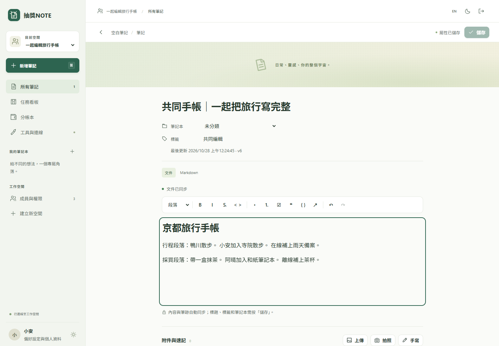
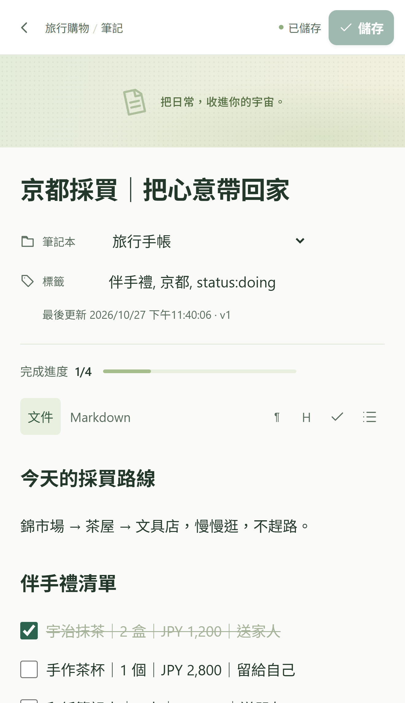
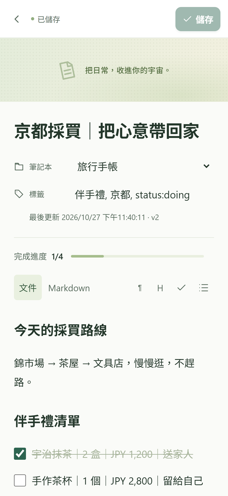

<h1 align="center">LuckyNote · 抽獎NOTE</h1>

Travel lists, notes, sketches and shared expenses in one workspace.

  
  
  
  

  <a href="README.md">繁體中文</a> · <strong>English</strong> ·
  <a href="CHANGELOG.en.md">Changelog</a> · <a href="CONTRIBUTING.md">Contributing</a> ·
  <a href="https://github.com/tonykfr1234/lucky-note/releases">Downloads / Releases</a>

LuckyNote is a self-hosted responsive web app and PWA, with a separate device-storage mode and Android WebView wrapper source. It includes Traditional Chinese / English UI, light and dark themes, avatars, in-app branding, and ten AI-generated backgrounds.

**Version 0.2.0 implements real Tiptap + Yjs + Hocuspocus collaboration**: concurrent document editing, merging after reconnecting an open tab, and server persistence. This is an independent implementation. [Research and licensing notes](docs/RESEARCH.md) explain its references; features of reference products are not automatically features of LuckyNote.

## Modes and publication status

Local review: [2026-10-29 UI changes, validation and rollback](docs/UI_UX_2026-10-29.md). Before/after screenshots remain local pending separate disclosure approval. This record does not imply a push, deployment or a new passing remote CI run.

| Mode | Where data lives | Available scope |
| --- | --- | --- |
| Self-hosted server / PWA | Your server's SQLite database and attachment directory | Accounts, private/group workspaces, collaboration and shared expenses; integrations require configuration |
| Device mode / Android wrapper | IndexedDB for that browser origin or app | Personal notes, templates, attachments, sketches, personal expenses and import/export; no server account or collaboration connection |
| Static Pages preview | That browser's IndexedDB | Device-mode experience; examples are synthetic and data is not automatically uploaded to a server |

- **Expected Pages URL — CI/publication confirmation pending:** [tonykfr1234.github.io/lucky-note](https://tonykfr1234.github.io/lucky-note/). This document does not yet confirm availability. The published preview will remain device-only.
- **Android debug APK — CI artifact/publication confirmation pending:** check the [Android workflow](https://github.com/tonykfr1234/lucky-note/actions/workflows/android.yml) and [Releases](https://github.com/tonykfr1234/lucky-note/releases). A downloadable build requires an actual APK, signature verification and SHA-256 report. See [Android documentation](docs/ANDROID.md), which includes an English guide.
- **iPhone:** use the website / PWA. No iOS IPA is provided. Browser viewport screenshots do not establish physical-device installation support.

The Android wrapper bundles the device front end and does not require another computer to remain running. It is a **debug development WebView build**, without production signing or store distribution. Shared HTTPS servers open in the system browser. Debug certificates may change between builds; export notes before uninstalling if an update cannot replace the previous installation.

## Features

| Feature | Implemented in 0.2.0 |
| --- | --- |
| Notes and organization | Tiptap rich text, interactive checklists, notebooks, tags, search, card/table/board views |
| Templates | Twelve purposes plus a blank note: travel, packing, groceries, shopping, tasks, SOP, meetings, journal, learning, expenses, maintenance and ideas |
| Media and handwriting | Explicit photo/video/file selection, camera entry point, 20 MB attachment limit; pen colors, widths, eraser, undo/redo, PNG and editable strokes |
| Collaborative editing | Server-mode Yjs content merging; SQLite journal commits before apply/acknowledgement, with restart recovery; separate versions for titles, tags and other metadata |
| Private and group workspaces | Owner/editor/viewer roles, ACL checks per request and message, revocation/session disconnects; production email sharing requires verified Google identities |
| Expense splitting | Server groups use integer TWD minor units, deterministic rounding, balances, settlement suggestions and recipient confirmation; device mode has personal expenses only |
| Language and appearance | Traditional Chinese / English, light/dark themes, avatars, in-app name/icon, ten AI backgrounds and custom backgrounds |
| Portability | Notes/notebooks JSON import/export and Markdown export; JSON excludes attachments, expenses, members and collaboration history |
| Extensible tools | Server adapters for Google sign-in, Drive, Calendar, Gmail, LINE Messaging API and AI classification/translation; explicit unconfigured states. The STT adapter has tests, but its paid-operation UI is not enabled |

**Handwriting collaboration replaces a whole canvas value.** Strokes are stored together in metadata.sketch. Concurrent changes prompt before replacement; strokes are not individually merged as a CRDT. Awareness is disabled in this version, so there are no collaborative cursors or online-user counts.

In-app branding does not rewrite operating-system installation metadata. PWA names/icons come from the deployed manifest; Android launcher branding comes from APK resources.

## Screenshots

These show the running app with synthetic data. Phone images are browser viewport/layout tests, not installations on physical iPhones or Galaxy phones.

<table>
  <tr><th>Desktop collaboration</th><th>iPhone 16 Pro Max viewport</th><th>Galaxy S26 layout range</th></tr>
  <tr>
    <td align="center"></td>
    <td align="center"></td>
    <td align="center"></td>
  </tr>
</table>

[Ledger](docs/screenshots/desktop-ledger-zh.png) · [Mobile board](docs/screenshots/mobile-board-zh.png) · [Background gallery](docs/screenshots/background-gallery-zh.png) · [Mobile validation and physical-device limits](docs/MOBILE-VALIDATION.md)

## Quick Start

Requires **Node.js 22.17+** and **npm 8+**. Run from the repository root. Initial dependency installation needs access to the npm registry.

### Server mode

~~~sh
npm ci --ignore-scripts
npm run build
npm start
~~~

Open http://127.0.0.1:4317 and create a local password account. The server binds to loopback by default and stores data under ./data/. This local server differs from IndexedDB device mode. Node 22 may display an experimental SQLite warning.

Passwords use scrypt. Local registration **does not verify email ownership**; development group accounts are test identities. Production email sharing requires verified Google identities for both owner and recipient. Production startup requires an HTTPS APP_ORIGIN, a secure SESSION_SECRET and authentication configuration, and fails closed when these are missing.

Copy [.env.example](.env.example) to .env when configuring the app. See [deployment and backup instructions](docs/DEPLOYMENT.md). Never commit .env, databases, media, tokens, keystores or backups. Without a fixed local session secret, restarting requires signing in again; notes remain stored.

### Device mode and a local preview of the Pages path

~~~sh
npm run build:local
npm run preview:local
~~~

Open http://127.0.0.1:4320. This serves static assets; notes live in browser IndexedDB and require no login or API server.

~~~sh
npm run build:preview
npm run preview:web
~~~

Open http://127.0.0.1:4320/lucky-note/ to check the expected Pages path. Both preview servers use the same default port; run one at a time. A successful build does not mean Pages has been deployed.

Browsers, origins and APK installations have separate stores. Clearing site data, private browsing or uninstalling the app can remove data. Export regularly and save attachments separately. JSON is not a full backup. When importing notes from JSON, device mode converts supported Markdown block syntax and preserves other inline syntax as literal text. Pages still loads website assets and does not guarantee offline cold starts; the APK bundles those assets.

### Docker

With Docker and Compose already installed:

~~~sh
docker compose -f compose.local.yaml up --build -d
~~~

Open http://127.0.0.1:4317. Production compose.yaml and backup/restore procedures are described in [deployment documentation](docs/DEPLOYMENT.md). Docker build and volume recovery have not been tested on GE76 because Docker CLI is unavailable there.

## Synchronization, offline behavior and integrations

In server mode, Yjs is the canonical document; Markdown is a search/export projection and SSE refreshes lists and metadata. Disconnected edits in an **already-open tab** remain in memory and merge on reconnect. Unsynced server-mode changes are not persisted to IndexedDB, so closing or reloading the tab may lose them. This is not a complete offline notebook library. The service worker does not cache private APIs, attachments or group data.

| Integration | Boundary |
| --- | --- |
| Google sign-in | Requires your OAuth client and redirect configuration; login does not grant Drive, Calendar or Gmail access |
| Group Google Drive | Stores attachments/snapshots; it does not replace ACLs or the CRDT database. A shared My Drive folder is not a Workspace Shared Drive |
| Calendar / Gmail / LINE | Separate permissions, explicit workspace/destination bindings and preview/confirmation; live external delivery still requires credential-backed acceptance testing |
| AI classification / translation | Server-side keys; selected sources, date/timezone, budgets, preview and human confirmation. OpenAI API billing is separate from ChatGPT subscriptions |
| Photo library | No automatic whole-library scan; Google Photos Picker is not implemented |
| Splitting / payments | Ledger, suggestions and manual confirmation only; no LINE Pay P2P, money transfers or custody |

See [integration documentation](docs/INTEGRATIONS.md). No OAuth grant, real push, email, calendar event or payment was performed for this delivery. The store:false setting does not promise zero provider retention.

## Verification and development

~~~sh
npm run verify
npm run test:e2e
npm run test:local
~~~

Local 0.2.0 validation passed **116 automated tests, seven server UI tests and two device UI tests**. Supporting evidence includes [34 core/collaboration security regressions](artifacts/backend-crdt-tests.log), [real browser collaboration](artifacts/collaboration-browser.log) and the [front-end validation record](artifacts/frontend-crdt-validation.md). Coverage includes cross-workspace isolation, forged viewer updates, revocation, expiry, storage failure, restart after abrupt termination following an ACK, and live/offline merging. See [acceptance documentation](docs/ACCEPTANCE.md) for the complete matrix. The GitHub badge reflects actual remote CI, not an assumed result from local tests.

Playwright uses the configured Chrome path on Windows and Chromium in CI. Provider mock tests do not prove real external delivery. Android compilation, signature verification, emulator launch and physical-device testing are separate outcomes. See [CONTRIBUTING.md](CONTRIBUTING.md) for the development workflow.

## Documentation and license

| Document | Contents |
| --- | --- |
| [Architecture](docs/ARCHITECTURE.md) | Storage, authorization, collaboration and extensions |
| [Deployment](docs/DEPLOYMENT.md) | Node/Docker, production settings and backup/restore |
| [Integrations](docs/INTEGRATIONS.md) | Google, LINE and AI configuration and limits |
| [Acceptance](docs/ACCEPTANCE.md) | Implemented, tested, credential-dependent and outstanding work |
| [Android](docs/ANDROID.md) | Debug APK, permissions, export and CI/device boundaries |
| [Security policy](SECURITY.md) | Security boundaries and reporting |
| [English changelog](CHANGELOG.en.md) · [繁中更新紀錄](CHANGELOG.md) | Changes and release status |

Remaining work includes durable server-mode offline storage, stroke-level canvas collaboration, group OAuth/token management, Google Photos Picker, scheduled notification delivery, production Android signing/device testing and a full accessibility audit. No end-to-end encryption is claimed. Protect server data and backups appropriately.

Project source is licensed under [MIT](LICENSE). See [THIRD_PARTY_NOTICES.md](THIRD_PARTY_NOTICES.md) for dependency notices. Research references are not necessarily included dependencies.

---

**Build by Tony · 2026 年製作**
