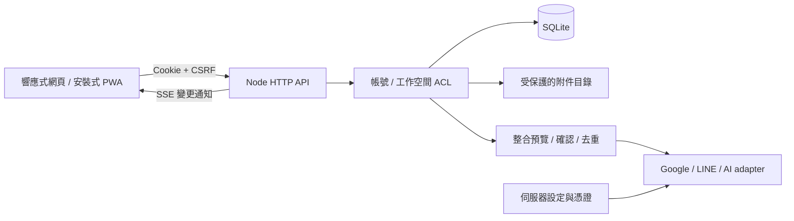

# 架構與部署

## 系統構成

LuckyNote 採單一 origin 的 React／TypeScript 前端與 Node HTTP 後端，後端使用 SQLite 和本機附件目錄。這降低第一版的部署複雜度，也讓權限測試能在隔離暫存資料庫執行。

Vite 只負責前端編譯。伺服器程式和憑證不進入前端 bundle；客戶端只收到配置狀態，不收到 token 或 API key。外部整合可替換 adapter，不要求重新拼接另一套筆記產品。

## 資料與權限

| 資料 | 擁有與隔離方式 |
| --- | --- |
| 帳號／session | 使用者身份由伺服器驗證，session cookie 對應伺服器記錄 |
| 工作空間／成員 | 私人空間只有本人；群組 owner 管理 editor、viewer |
| 筆記本／筆記 | 必須屬於同一工作空間；寫入同時核對成員角色與版本 |
| 附件 | 以隨機 ID 對應筆記，下載也必須重新檢查筆記所在空間的權限 |
| 分帳 | 參與者需為該空間成員，整數最小幣值計算 |
| 整合操作 | 群組授權與 server-side binding 分開檢查，不接受任意前端 token |

owner 可管理群組成員；editor 可編輯內容；viewer 只能讀取。從其他群組取得的筆記／附件 ID 不應形成存取權。前端隱藏按鈕只改善體驗，不能代替伺服器權限檢查。

## 儲存、同步與衝突

每次筆記寫入帶上讀取時的 `version`。伺服器僅在目前版本一致時更新，否則回傳 `409`，讓使用者保留尚未存入的修改並處理衝突。成功寫入後發送 SSE 通知，接收端再讀取自己有權限看到的資料。SSE 只傳變更資訊，不推送跨工作空間內容。

這是線上協作的樂觀版本控制，並非 CRDT、OT 或離線自動合併。斷線後重新連線必須重新讀取版本；不能把已失去權限的舊資料再寫回。SSE 連線仍需處理 session 到期、登出、撤權和重連。

建立資料時以 `clientMutationId` 去重，避免重複點擊或重試造成重複紀錄。整合外部服務有額外的不確定性：網路逾時可能代表上游已處理而本機未收到結果，不可直接當作「失敗且一定未執行」重送。

## 檔案與手寫

附件透過已登入、具編輯權的筆記路徑上傳，限制大小並使用 MIME 白名單。第一版 JSON/base64 上傳會增加傳輸與記憶體成本，適合小型照片和短影片；大型影片、分段續傳、病毒掃描與物件儲存是後續擴充。

附件不放在可匿名存取的前端 `public/`。HTML／SVG 等可執行主動內容不接受為一般附件。手寫畫布應由使用者明確保存，預覽不等於已上傳；可否保留向量筆跡再次編輯，以實際驗收結果為準。

## 身份模式

本機模式綁定 loopback，採密碼驗證，用於個人使用和驗收。它不是假 Google 登入，也不是輸入 email 即取得身份。正式模式需要明確的 `APP_ORIGIN`、安全 session 設定和已配置的登入方式；缺失時拒絕啟動。

Google OAuth 只驗證身份，Drive、Calendar、Gmail 分別需要最小權限與個別配置。沒有使用者同意時不擴大 scope。不把相同 email 的本機帳號和 Google 帳號靜默合併，避免不明確的帳號接管。

## 部署模式

- 單機開發／個人使用：Node 服務與 SQLite 位於同一主機，預設 `127.0.0.1:4317`。
- 正式多使用者：HTTPS 反向代理、受限伺服器環境變數、持久化資料卷、明確的 OAuth client 和備份政策；需完成外部登入與送達驗收。
- 多副本與高流量：不應直接把 SQLite 檔案共享給多個任意節點。後續需改為支援交易的中央資料庫、共享 session、事件匯流排與物件儲存。

Docker 應掛載完整 `DATA_DIR`，以非 root 使用者運行，僅映射需要的 port。正式流量交由 HTTPS 代理；不要為了測試直接改防火牆或公開本機服務。環境變數和實際命令以根目錄 `.env.example`、Docker 檔案為準。

## 備份與復原

1. 停止應用程式，避免 SQLite 和附件仍在寫入。
2. 複製整個 `DATA_DIR` 到存取受限的位置；記錄時間、版本和 SHA-256，避免只複製 DB 而遺漏附件或 WAL。
3. 另外保管伺服器設定；不要把憑證寫進公開紀錄。
4. 在隔離目錄還原完整備份，使用相同或已驗證的程式版本啟動。
5. 驗證登入、跨空間拒絕存取、筆記內容、附件和分帳總額，再決定正式切換。

回復部署時保留舊程式與舊資料目錄。資料遷移之後不能只換回舊 binary 就假設相容。UI 的筆記匯出只是可攜內容，不包含 session、群組 ACL、外部憑證等完整服務狀態。

## 擴充介面

`IntegrationContext` 由後端提供已解析請求、已登入使用者、工作空間授權函式、資料庫和 server-side 環境設定。新 provider 應沿用預覽／確認流程，先驗證角色和目標，再建立去重操作記錄，最後呼叫受限制的固定上游網域。

AI 的輸入來源必須明確選取，記錄 cutoff 日期和時區，限制單次項目數、請求數與 token／金額預算。模型輸出是待確認的建議，不能直接把私人內容移進群組或對外發送。使用者提供的筆記與模型輸出都視為資料，不能作為執行系統命令的指令。
