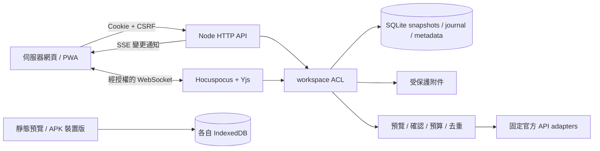

# 0.2 架構與部署

抽獎NOTE / LuckyNote 共用 React、TypeScript 與 Tiptap 前端，提供伺服器協作版及裝置本機版。兩種模式不會自動共用筆記。

| 模式 | 儲存與身分 | 同步能力 |
| --- | --- | --- |
| 伺服器網頁／PWA | Node HTTP、SQLite、受保護附件；session 與 workspace ACL | Hocuspocus WebSocket + Yjs 文件協作；SSE 通知列表／中繼資料變更 |
| 靜態預覽／裝置本機版 | 目前 origin 與瀏覽器資料容器內的 IndexedDB；本機設定檔不是 Google 身分 | 裝置內持久儲存；沒有伺服器 session、群組共享、WebSocket 或 SSE |
| Android APK 裝置版 | WebView 內建同一套裝置版前端；App 自己的 IndexedDB | 不與預覽網站、其他 App 或其他裝置共用資料；HTTPS 服務在系統瀏覽器另開 |

預覽版只在指定 preview build 初始化明確標示的合成筆記；訪客在自己的瀏覽器編輯。清除網站資料、結束無痕模式、解除安裝或系統回收儲存可能失去本機內容，應自行匯出備份。IndexedDB 不代表端對端加密或同一資料容器使用者之間的存取控制。

## 文件與即時協作

鎖定 Tiptap 3.32.0、`@tiptap/y-tiptap` 3.0.10、Yjs 13.6.33、Hocuspocus 4.7.1。前後端共用 `shared/editor-schema.ts`；`server/note-format.ts` 負責伺服器 Markdown 遷移、驗證與投影。前端掛載已同步 Y.Doc，不以 `setContent` 重複初始化。

正文是 `Y.XmlFragment('content')`，提供富文字、清單／待辦、引言、程式碼與安全連結。手寫存在 `Y.Map('metadata').sketch`，值為向量 JSON 的 base64；這是整張畫布的值，並非逐筆畫 CRDT，遠端變更會提示確認。Tiptap 必需的位置遷移 root 依釘選版本完整形狀驗證；其他未知 roots／屬性、危險 URL、嵌入資料、畸形 Unicode、過深結構及超限文件拒絕。此版不啟用 awareness／他人游標。

SQLite 保存 canonical Yjs 二進位 snapshot 與更新 journal。每份文件的寫入鎖涵蓋驗證至套用：先在影子文件套用更新，重新驗證 session、成員、寫入權限、完整依賴、schema 與大小，再同步提交 journal，最後允許核心套用與回應。未解析 pending structs／delete sets 不會入庫；重連須同步完整缺少狀態。viewer 不能透過 SyncStep2 寫入。

正文增加 `content_revision`；標題／標籤／筆記本及確認 AI 分類增加 `metadata_version`；兩者都增加總 `version`。協作筆記拒絕舊 REST 正文 PATCH。中繼資料仍使用 `metadataVersion` 與 `409` 防止舊值覆寫，正文則由 CRDT 合併。

保持開啟的同一分頁在短暫斷線時保留 Y.Doc，重連可合併雙方文字變更。伺服器版沒有 IndexedDB 離線副本；關閉、切換筆記或重新整理可能失去未同步內容，介面提示並提供草稿匯出。裝置本機版的 IndexedDB 持久保存是另一模式。

## 遷移、搜尋、匯出

舊 Markdown 只在伺服器遷移一次，snapshot 保存 `legacy_content` 原文及 schema version。失敗保留原文，不截斷或丟棄內容冒充成功。原始 HTML 當 literal text，不能執行。暫不支援的 Markdown 圖片、表格及非十進位有序清單明確拒絕遷移；媒體可使用獨立附件功能。

`notes.content` 是 canonical Y.Doc 派生的 Markdown 與手寫標記，供搜尋／可攜匯出；Markdown source 為唯讀。程式碼圍欄、連結、段落起始符號已回歸。Markdown 仍可能正規化部分空白與格式，不是所有任意富文字結構的完整保真備份；完整復原須保留 SQLite canonical Yjs 與附件。

## 身分、權限與刪除

每次筆記、筆記本、附件、帳本、匯出、SSE、WebSocket 與整合操作重新檢查 workspace。知道 UUID 或隱藏前端按鈕不構成授權。owner 管理群組，editor 編輯，viewer 唯讀；撤權、降級、登出與 session 到期會重驗或關閉既有連線。

本機密碼使用 scrypt，不是 email-only 登入。Google 登入驗證 PKCE、一次性 state、nonce、JWKS 簽章、issuer／audience／期限及 userinfo 一致性；不自動合併同 email 本機帳號。正式群組新增成員需雙方 Google 驗證，既有未驗證本機非 owner 成員亦不得存取群組。

一般去重紀錄保存資源參照；刪除後留下不含全文的 tombstone，重送 mutation ID 不能復活或讀回已刪資源。筆記刪除同時移除 canonical snapshot／journal 與附件關聯。邏輯刪除不代表資料檔案及歷史備份已完成鑑識級抹除。

## 附件與外部整合

上傳／下載及 range 均有 ACL、大小、MIME 與檔頭檢查；附件不放公開 `public/`，HTML／SVG 不作為主動附件接受。JSON/base64 適合目前小型媒體；大型續傳、病毒掃描、轉碼與物件儲存待擴充。

Google 登入與 Drive／Calendar／Gmail 授權分開。Drive 儲存附件或快照，不替代協作資料庫。LINE 使用 Messaging API，不使用 LINE Notify。分帳僅帳本與結清建議，沒有代管資金或 LINE Pay P2P 轉帳。

整合需固定官方端點、server secrets、目前 group owner、既有目的地 binding、預覽與明確確認。確認時重驗 binding，outbox 去重；結果不明不自動重送。缺憑證明確回報未配置。

AI 目前僅送使用者選取並預覽的標題／標籤，不讀正文、不掃相簿、不傳未選相片。日期與時區保存於預覽，分類需人工確認。單次上限之外，使用者／workspace／部署 UTC 每日 token 額度在同一 SQLite 交易保留，詳見 [整合說明](INTEGRATIONS.md)。模型輸出是資料，不是工具指令。

## 部署與復原

開發預設 `127.0.0.1:4317`。正式伺服器需 HTTPS、正確 `APP_ORIGIN`、非範例 `SESSION_SECRET`、合法登入設定、OS 資料目錄權限與備份。反向代理須支援 WebSocket upgrade／SSE。不可把 SQLite 直接交給多個獨立協作節點共享；多節點需重設文件協調、session、事件與儲存。

Docker 採非 root 與持久目錄；實際建置／啟動狀態見 [驗收](ACCEPTANCE.md)。APK 的 build、簽章及裝置驗證見 [Android 說明](ANDROID.md)，有原始碼／workflow 不代表已產出 APK。

復原前停止寫入，備份完整 `DATA_DIR`、附件及必要 SQLite WAL，另保管秘密。先在隔離目錄用相容版本驗證登入、跨群組拒絕、協作、附件與帳本總額，再切回服務。UI JSON／Markdown 不含完整 session、ACL、秘密及 canonical 協作歷史；遷移後不能只回退程式並假設資料相容。
