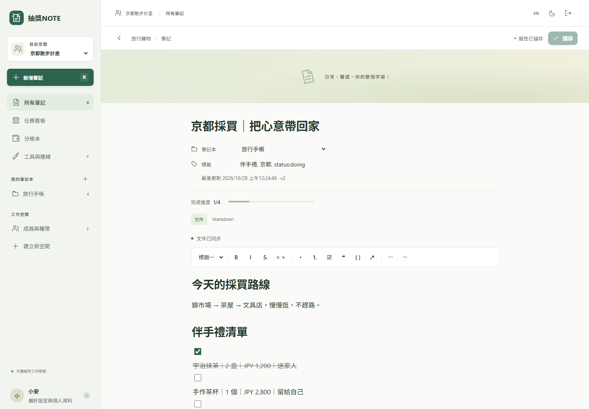
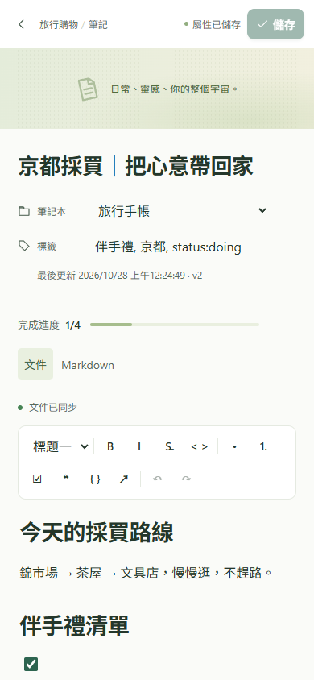
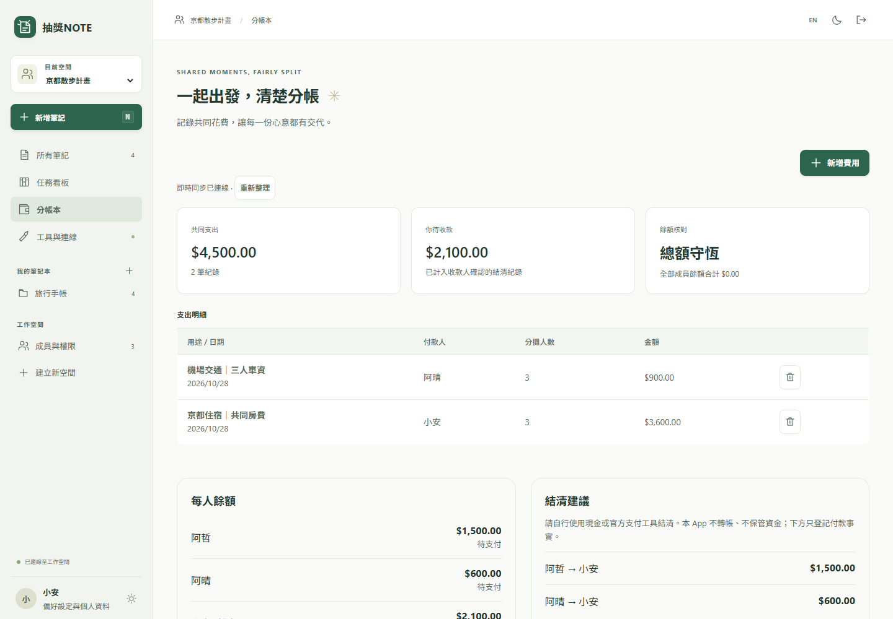
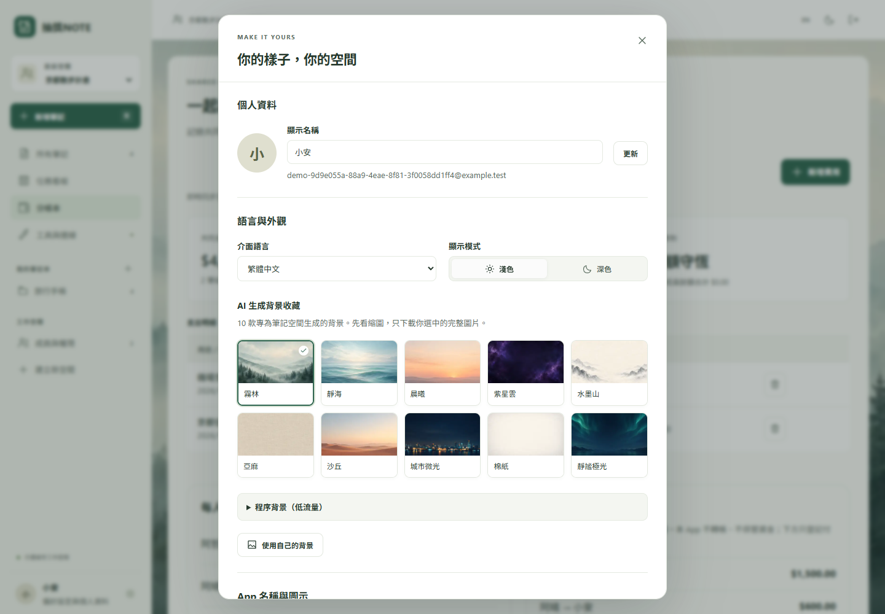

# 抽獎NOTE 0.2 使用手冊

[English guide](USER_GUIDE.en.md) · [安裝與部署](DEPLOYMENT.md) · [Android APK 詳細說明](ANDROID.md)

本手冊說明目前實際可操作的功能。畫面中的名稱預設為「抽獎NOTE」，切換英文介面不會自動改名；你可以在個人設定自訂名稱。產品體驗包含富文字文件、手寫畫布、筆記資料表與看板，但不是 AFFiNE 或 AppFlowy 的完整功能複製。

## 1. 先確認你使用哪一種模式

| 模式 | 資料在哪裡 | 登入與共享 | 離線與安裝 |
| --- | --- | --- | --- |
| 自架伺服器網頁／PWA | 維護者的伺服器資料庫與附件目錄 | 伺服器帳號；設定完成後可 Google 登入與群組協作 | 已載入的文件可在目前分頁暫存修改，重新連線後合併；不是完整離線資料庫 |
| 本機網頁預覽 | 這個網站來源、這個瀏覽器的 IndexedDB | 自動使用「此裝置」身分，沒有 Google 登入或遠端群組 | 初次載入頁面需要網路；本機資料庫可持久保存，這個版本不為預覽註冊離線 service worker |
| Android 本機 APK | 該 App 自己的 IndexedDB，與手機瀏覽器分開 | 無需登入；沒有內建多人伺服器連線 | 打包介面可離線開啟；是 WebView 封裝，不是原生重寫 |

本機模式上方會顯示「此裝置模式」。網頁預覽中的「【示範】」旅行、購物與 SOP 是可編輯、可刪除的合成範例，不是他人的筆記。APK 的本機資料不會自動移到網站、其他裝置或自架伺服器；需要時用 JSON 匯出／匯入搬移筆記。

伺服器版與本機版的「私人」含義不同：伺服器版由帳號與工作空間權限控制；本機版依賴裝置和瀏覽器的存取保護，沒有另一層 App 登入密碼，也沒有端到端加密宣稱。

## 2. 開始使用與安裝

### 自架網頁／PWA

1. 開啟維護者提供的 HTTPS 網址。伺服器未啟動時，單靠安裝 PWA 不會讓後端上線。
2. 使用已配置的登入方式。Google 按鈕顯示未配置時，需要維護者完成 OAuth 設定；不要把 API key 貼進介面。
3. iPhone 使用 Safari 的分享選單，選擇「加入主畫面」；Android 使用支援的瀏覽器選單，選擇「安裝應用程式」或「加入主畫面」。選項名稱與可用性依瀏覽器版本而異。
4. 更新前先等文件顯示「已同步」，並儲存筆記屬性；不要靠重新整理處理尚未同步的草稿。

PWA 與網頁共用同一套介面。App 內自訂的品牌名稱與圖示不會直接改寫系統已安裝圖示；主畫面名稱、圖示及其更新時機由部署資產與作業系統決定。

### Android APK

若維護者已發布可下載的 APK，從本專案的 [Releases](https://github.com/tonykfr1234/lucky-note/releases) 取得，核對同次發布的 SHA-256 與驗證報告。原始碼或 workflow 存在不代表 APK 已成功建置；請以實際產物為準。

目前是 Android 8.0 以上的 **debug 開發測試 APK**，不是 Play 商店正式版。只有在你信任發布來源時才允許該來源安裝，不必關閉 Play Protect。iPhone 不能安裝 APK，請使用網頁／PWA。

不同建置的 debug 簽章可能不同，無法保證覆蓋升級。遇到簽章不相容時，**先匯出備份，再考慮移除舊版**；移除 App 會刪除其本機資料。自架 HTTPS 服務連結會由系統瀏覽器開啟，APK 本機筆記不會自動傳過去。詳見 [Android 說明](ANDROID.md)。

## 3. 建立第一篇筆記

1. 選擇工作空間；手機可先按左上角選單。
2. 按「新增筆記」，選空白或模板。取消模板視窗不會建立筆記。
3. 輸入標題，在「文件」分頁直接編輯內容。
4. 選擇筆記本、填寫逗號分隔的標籤，再按右上角「儲存」。

文件內容與筆記屬性採用不同儲存方式：

| 資料 | 伺服器模式 | 本機模式 |
| --- | --- | --- |
| 富文字內容與手寫資料 | 自動協作同步，顯示「文件已同步」後才代表已收到伺服器確認 | 自動寫入裝置資料庫，完成後顯示「已儲存至此裝置」 |
| 標題、標籤、筆記本 | 按「儲存」 | 按「儲存」 |
| 照片、影片等附件 | 選取後上傳，完成後出現在附件區 | 選取後存到此裝置 |

「屬性已儲存」不代表文件內容一定已同步，請同時看文件上方的狀態。

截圖來自實際 Chrome 執行與合成測試資料；手機尺寸截圖不代表已在實體手機完成安裝或相機測試。

## 4. 富文字、清單與模板

工具列提供段落／標題、粗體、斜體、刪除線、行內程式碼、項目清單、編號清單、待辦清單、引用、程式碼區塊、連結、復原與重做。先選取文字再套格式，或先選格式再輸入。待辦方框可直接勾選，文件上方會顯示完成進度。

「Markdown」分頁是**目前文件的唯讀匯出檢視**；要修改內容請回到「文件」。連結輸入會檢查格式，取消連結視窗不會更動文件。

除空白筆記外，提供以下 12 種可編輯起點：

| 模板 | 適合用途 |
| --- | --- |
| 旅行計畫 | 目的地、每日行程、住宿與交通 |
| 行李清單 | 證件、衣物、隨身物品與數量 |
| 日常採買 | 採買人、預算、數量、幣別、狀態 |
| 旅行購物 | 願望清單、伴手禮、收禮人與店家 |
| 待辦事項 | 今日優先順序、每週計畫、完成條件 |
| 標準作業 SOP | 文件版本、負責人、生效日、步驟、驗收與回復方式 |
| 會議紀錄 | 議程、決議、待辦、負責人與期限 |
| 每日手記 | 心情、小成就與下一天的計畫 |
| 學習筆記 | 資料來源、概念、疑問與練習 |
| 費用紀錄 | 收據、付款人、參與人與備註 |
| 維修紀錄 | 設備現象、診斷、備份、修復與驗收 |
| 靈感收集 | 想法、參考、草圖與下一個實驗 |

模板中的 SOP 版本、購物數量、價格與狀態是可編輯文件內容，不會自動執行流程、追蹤修訂或換匯。費用模板也不會自動建立分帳項目；要計算分攤，請另到「分帳本」。

## 5. 整理、搜尋與手機操作

- **工作空間**：分開私人筆記與不同群組。搜尋、筆記本和看板依目前工作空間顯示。
- **筆記本**：從側欄新增，再於筆記屬性選取。
- **標籤**：在筆記屬性以逗號分隔，儲存後可用上方標籤篩選。
- **搜尋**：搜尋目前空間的筆記標題、內容與標籤；不是照片 OCR 或影片內容搜尋。
- **卡片／資料表**：切換同一批筆記的呈現方式。資料表不是可自訂任意欄位的關聯式資料庫。
- **任務看板**：依待處理、進行中、已完成分類；可拖曳或使用卡片上的狀態選單。看板狀態使用筆記標籤，與文件內的待辦方框分開。

手機返回／瀏覽器返回會先關閉開啟的對話框或筆記。有未儲存或未同步的變更時，可取消離開以保留草稿。鍵盤開啟時可捲動文件；不要把畫面暫時被鍵盤遮住誤認為內容遺失。

[手機任務看板](screenshots/mobile-board-zh.png) · [iPhone 尺寸畫面](screenshots/iphone16-pro-max-portrait.png) · [Galaxy 尺寸畫面](screenshots/galaxy-s26-360-portrait.png)

## 6. 照片、影片、拍照與手寫

在筆記下方按「上傳」選取檔案，或按「拍照」交由裝置的相機／選檔流程處理。取消選檔不會上傳；App 不會預設掃描整個相簿。每個附件上限 20 MB，格式與實際檔案內容會被檢查；可播放的影片／聲音格式仍受瀏覽器和裝置解碼能力影響。相機權限與原生拍攝流程需要在你的手機確認。

按「手寫」開啟畫布，可選筆色、筆寬、橡皮擦、復原／重做及清除。儲存會保存可再次編輯的筆跡，並加入 PNG 附件；之後按「編輯速記」繼續修改。

**畫布是整份儲存，不是逐筆畫的多人合併。** 多人同時儲存可能取代彼此版本，建議各自使用不同筆記。開啟畫布期間收到其他人的更新時，會保留你的本地筆跡並在覆寫前確認。若筆跡已存、PNG 儲存失敗，畫布會保留供重試。

目前 APK 的原生匯出只支援 JSON／Markdown／純文字，不支援將照片、影片等附件另存到外部；附件仍可在 App 內預覽。重要原始媒體請保留自己的備份。

## 7. 群組與真正協作

此節適用於伺服器模式。本機預覽與 APK 不建立遠端群組。

1. 先由維護者部署 HTTPS 伺服器並配置登入。
2. 建立「群組空間」，在「成員與權限」加入已在同一伺服器註冊的帳號。
3. 指定 editor 或 viewer。owner 管理成員；editor 可修改；viewer 只能閱讀。
4. 成員開啟同一篇文件即可共同編輯。文字內容使用 CRDT 合併；沒有顯示未實作的「誰在線上」或協作者游標。

正式分享要求擁有者與被加入者都使用已驗證的 Google 身分。開發環境本機帳號僅是測試身分，輸入某個 Email 不代表擁有該信箱；加入成員不會寄出邀請信。Google 登入不等於已授權 Drive、Gmail 或 Calendar。

斷線後已開啟的文件可留在**目前分頁記憶體**繼續編輯，重連後合併；關閉分頁、切換筆記、重新整理或系統終止瀏覽器都可能失去尚未同步的內容。請保持分頁開啟，必要時先匯出草稿。伺服器拒絕更新、登入失效或撤權時會停止編輯，不能當成一般離線繼續送出。

標題、標籤與筆記本採用獨立版本保護。遇到較新版本時，不會自動覆蓋他人屬性：先「下載我的草稿」，再「載入遠端屬性」比較。文件內容的協作狀態與此屬性衝突分開處理。

## 8. 分帳本

1. 進入「分帳本」並按「新增費用」。
2. 填寫用途、新台幣金額、實際付款人，勾選平均分攤成員。
3. 儲存後查看每人餘額與結清建議。

目前帳本使用 **TWD、最多兩位小數**，以整數最小幣值計算；除不盡的餘數按固定規則分配，總額保持一致。這不是多幣別帳本；筆記模板內寫 JPY 不會觸發換匯。

結清請先在 App 外完成付款，再建立已付款紀錄；收款人確認實際收到款項後，帳本才更新結清餘額。按鈕不會透過 LINE Pay、銀行或其他工具轉帳，也不會保管資金。本機模式只有此裝置一個身分，可記自己的費用，無法模擬真正多人分帳。

## 9. 外觀、背景與外部工具

在「偏好設定與個人資料」可切換繁中／英文、深色／淺色、修改顯示名稱與頭像、自訂 App 內名稱／圖示。外觀設定依裝置保留。

背景有 10 張 AI 生成圖片、10 種程序生成背景，也可選自己的圖片。圖片集先載入縮圖，只載入選中的完整背景。頭像、圖示與自訂背景接受 512 KB 內 PNG、JPEG 或 WebP。

「工具與整合」會顯示實際配置狀態：

| 工具 | 目前可用範圍 |
| --- | --- |
| Google 登入 | 維護者配置 OAuth 後使用；沒有自動取得其他 Google 權限 |
| Drive、Calendar、Gmail、LINE | 有後端介面與預覽／確認設計；尚需管理者配置憑證、目的地與權限，完整操作 UI 仍有限，不能把狀態卡當成已送達 |
| AI 分類 | 伺服器配置 OpenAI key 後，選筆記、起始日期、時區與 token 預算；先預覽選取的 metadata，再確認發送，最後人工確認分類 |
| 翻譯 | 明確輸入文字、選語言並確認後才送出；結果需自行檢查與複製 |
| 語音轉文字 | 有後端 adapter，但一般使用者的完整上傳／計費確認流程尚未開放 |
| Google Photos／相簿掃描 | 尚未提供 Picker 操作，也不會背景掃描全部照片或影片 |

本機模式不連接上述外部服務。ChatGPT 訂閱不包含 OpenAI API 額度；AI 有單次及每日預算限制。不要將 API key 填入筆記、前端設定或公開 GitHub。服務顯示「未配置」時，核心筆記仍可使用；詳見 [整合說明](INTEGRATIONS.md)。

## 10. 匯出、還原與資料保護

### 筆記搬移

- 單篇筆記下方的「匯出 Markdown」匯出目前文件文字，適合閱讀或保留文字草稿；不是附件或完整手寫備份。
- 在筆記列表的「更多操作」選「匯出筆記 JSON」，取得目前工作空間的筆記與筆記本。
- 在目標工作空間選「匯入筆記 JSON」。請使用本 App 的相容匯出格式，先在空白測試空間驗證；不是任意 Notion／Evernote 匯入器。
- 匯入會建立筆記，不是覆蓋同步。相同操作的重送有去重，但重新啟動一個匯入操作仍可能建立新的副本。

JSON **不包含附件二進位檔、分帳紀錄、帳號、成員／權限、外部服務設定、個人外觀或完整協作歷史**。筆記內容內的手寫資料可隨相容格式保留，但 PNG 原始附件不在其中；還原後請實際檢查。跨模式匯入會重新建立文件，本機匯入對部分 Markdown 行內格式採文字保留，不保證逐像素相同。

瀏覽器只能確認已提出下載，請檢查下載資料夾。APK 使用系統存檔選擇器；只有收到存檔成功結果才顯示成功，取消不是完成。APK 單次原生匯出上限 10 MiB。

### 避免本機資料遺失

本機筆記綁定網站來源、瀏覽器設定檔或 APK。無痕瀏覽、清除網站資料、瀏覽器重設、移除 APK、裝置故障或儲存空間回收，都可能讓資料消失；瀏覽器與 APK 不共用同一份資料。不要只因看見「已儲存」就假設已有外部備份。

完整伺服器備份由維護者依 [部署與備份說明](DEPLOYMENT.md) 執行，需一起保留資料庫、附件和必要設定。UI JSON 匯出不能取代完整備份。

## 11. 常見狀況

| 狀況 | 建議操作 |
| --- | --- |
| Save／儲存按鈕停用，但剛改過正文 | 正文自動儲存；按鈕只處理標題、標籤與筆記本。查看文件狀態 |
| 顯示離線或仍在同步 | 留在目前分頁；檢查網路與伺服器，必要時先匯出草稿 |
| 顯示權限變更或更新被拒絕 | 匯出仍可取得的草稿，再確認帳號與權限；不要反覆送出 |
| 本機容量不足／儲存失敗 | 保留頁面、先匯出資料，檢查裝置空間與瀏覽器儲存權限；不要直接清除網站資料 |
| 新裝置看不到筆記 | 確認模式、網址、帳號與空間；本機模式沒有跨裝置同步 |
| 相機或影片無法使用 | 檢查權限、格式與裝置能力；可改用選檔，取消不會建立附件 |
| Google 或 AI 無法操作 | 看配置狀態，交由維護者設定；本機模式本來就不提供外部連線 |
| 不確定新版 APK 能否覆蓋安裝 | 先備份，再核對發布簽章與說明；不要先移除仍存資料的舊版 |

[功能與驗收狀態](ACCEPTANCE.md) · [手機驗收範圍](MOBILE-VALIDATION.md) · [安全政策](../SECURITY.md)

